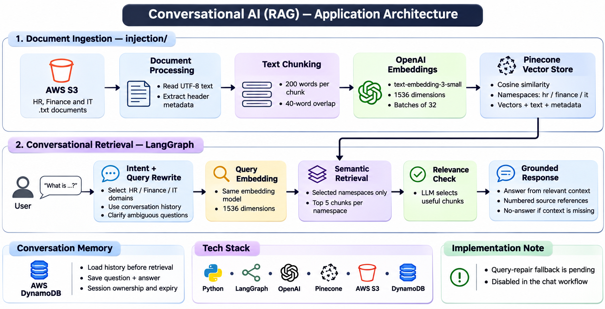

# Conversational AI — RAG Application

A Python-based Conversational AI application using Retrieval-Augmented Generation (RAG) to answer questions from organizational knowledge documents.

## Tech Stack
- Python
- LangGraph
- Pinecone Vector Database
- AWS
- Large Language Models (LLMs)

## Current Features
- Document ingestion and text chunking
- Vector embeddings and semantic retrieval
- Pinecone index and namespace-based document organization
- Domain-specific knowledge retrieval (HR, Finance, IT)
- LLM-generated answers grounded in retrieved context

## Architecture

[View the architecture diagram and implementation details](docs/architecture.md).

Documents → Text Processing → Chunking → Embeddings → Pinecone

User Question → Retrieval → Relevant Context → LLM → Answer

## Project Status
Active development. The core RAG question-answering workflow is functional.

## Planned Improvements
- Conversation memory
- Semantic caching
- Logging and monitoring
- Automated testing
- Input validation and error handling

## Setup
Installation and configuration instructions will be added based on the final repository structure.
