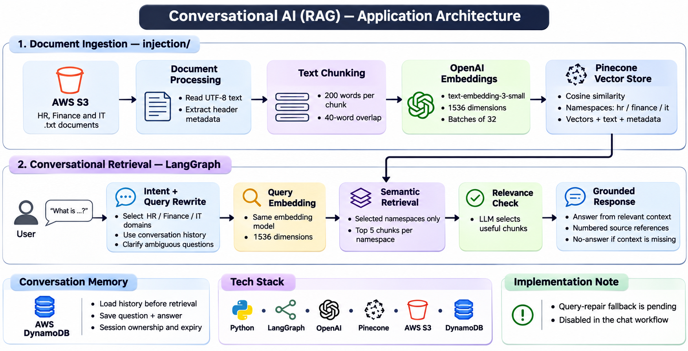
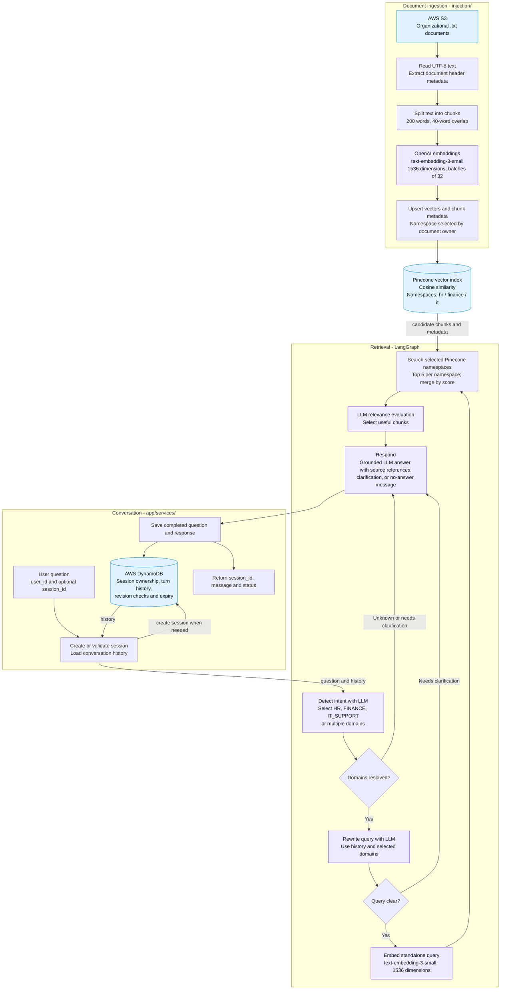

# RAG application architecture

This diagram follows the implemented ingestion (`injection/`) and retrieval
(`retrieval/`) code, including the chat service's DynamoDB memory integration.

## Implementation details

- **Ingestion:** `injection/ingest.py` reads S3 `.txt` files and parses document
  headers. Each vector stores chunk text, document ID, title, version, effective
  date, owner and audience. Vector IDs combine a hash of the bucket/key with the
  chunk number.
- **Domain mapping:** Human Resources maps to `hr`, Finance to `finance`, and
  IT Support to `it`. Retrieval searches only the selected domains.
- **Shared embeddings:** Both flows use `text-embedding-3-small` with 1536
  dimensions. Ingestion validates a ready Pinecone index with cosine similarity.
- **Conversation:** `app/services/chat.py` loads history before invoking the
  graph and saves the completed exchange before returning. DynamoDB memory
  defaults to 10 prior turns and seven days of retention.
- **Response paths:** Intent detection and query rewriting can request
  clarification. No relevant chunks produce a no-answer message; useful chunks
  are supplied to the answer model with numbered document references.
- **Pending fallback:** `retrieval/core/graph.py` defines a query-repair loop
  with up to three retries, but `retrieval/nodes/fallback.py` raises
  `NotImplementedError`. The chat service explicitly disables this loop, so it
  is omitted from the active flow above. Direct `build_graph()` calls enable
  fallback by default and may reach that unfinished node.

## Main source files

| Responsibility | Source |
| --- | --- |
| S3 ingestion and Pinecone upload | [ingest.py](../injection/ingest.py) |
| Chunking and document embeddings | [chunking.py](../injection/chunking.py), [embedding.py](../injection/embedding.py) |
| Graph and conditional routing | [graph.py](../retrieval/core/graph.py), [router.py](../retrieval/core/router.py) |
| Retrieval nodes | [nodes/](../retrieval/nodes/) |
| Query embeddings and vector search | [embeddings.py](../retrieval/services/embeddings.py), [vector_store.py](../retrieval/services/vector_store.py) |
| Chat and conversation history | [chat.py](../app/services/chat.py), [conversation_memory.py](../app/services/conversation_memory.py) |

GitHub renders the Mermaid diagram when viewing this Markdown file.
